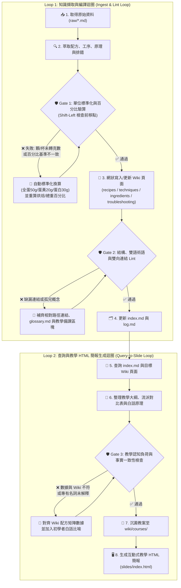

# AGENTS.md — 甜點教學與烘焙科學 LLM Wiki 規範 (Schema & Workflow)

本文件為 **甜點教學與烘焙科學知識庫 (Dessert Science & Teaching LLM Wiki)** 的核心架構規範（Schema）。參考 Andrej Karpathy 的 **LLM Wiki** 模式設計，旨在讓 AI Agent 扮演「嚴謹的烘焙知識庫維護者與教材編纂者」，將零散的原始食譜、科學文獻、主廚筆記與社群貼文，持續編譯（Compile）為結構化、跨頁互連、且具備**教學備課價值**的 Markdown 知識網路，並能進一步轉化為互動式 **教學 HTML 簡報**。

---

## 1. 三層架構與目錄結構 (Architecture)

本專案採用三層加一輸出的架構：
1. **Raw Sources (`raw/`)**：不可變（Immutable）的原始資料層。存放原始食譜文章、專業書籍摘錄、科學文獻、YouTube 逐字稿與社群配方筆記。LLM **只讀不改**。
2. **The Wiki (`wiki/`)**：由 LLM 全權維護的持久化知識庫。所有知識經由標準化換算、交叉比對與科學原理解析後寫入此層。為確保未來可無縫遷移至 GitBook、靜態網站或 Notion，**統一使用標準 Markdown 相對路徑連結**（如 `[梅納反應](../techniques/maillard-reaction.md)`），檔名採英文小寫 `kebab-case.md`。
3. **The Schema (`AGENTS.md`)**：本文件，定義目錄結構、換算規則、雙迴圈（Loop / Graph）工作流與檢查節點（Verification Gates）。
4. **Teaching Outputs (`slides/`)**：由 Wiki 知識庫查詢（Query）並通過教學檢核後產出的可瀏覽 **教學型 HTML 簡報**。

```text
d:\Antigravity\Dessert\
├── AGENTS.md                 # 核心 Schema 規範與 Loop/Graph 工作流定義
├── HOMEWORK_REPORT.md        # 作業繳交報告（含 Loop/Graph 設計說明、執行紀錄與反思）
├── raw/                      # 【第一層：不可變原始資料】
│   ├── 01-madeleine-ph-vs-classic.md
│   ├── 02-financier-beurre-noisette-science.md
│   ├── 03-canele-bordeaux-starch-gelatinization.md
│   ├── 04-macaron-meringue-schools-troubleshooting.md
│   └── 05-creme-patissiere-ganache-emulsion.md
├── wiki/                     # 【第二層：LLM 維護知識庫】
│   ├── index.md              # 全局內容目錄（Content-oriented Catalog）
│   ├── log.md                # 時間軸操作與檢查日誌（Chronological Audit Log）
│   ├── glossary.md           # 烘焙多語專有名詞對照表（繁中 / 法 / 英 / 日）
│   ├── recipes/              # 🍰 甜點品項與跨流派配方對照頁
│   ├── techniques/           # 🥣 烘焙技法與物理化學原理頁
│   ├── ingredients/          # 🧈 原料與食材科學頁
│   ├── troubleshooting/      # 🔍 常見失敗與排錯指南頁
│   ├── chefs/                # 👨‍🍳 主廚與流派體系專頁
│   └── courses/              # 🎓 教學備課教案與簡報大綱沉澱頁
└── slides/                   # 【輸出層：互動式教學 HTML 簡報】
    └── index.html            # 基於 Wiki 生成的初學者甜點科學教學簡報
```

---

## 2. 核心 Loop / Graph 流程設計與檢查節點 (Workflow & Verification Gates)

為確保烘焙數據的精準度與初學者教材的易懂性，本系統設計了 **雙迴圈圖譜（Dual-Loop Graph）**，並導入 **Shift-Left Validation（檢查前移）** 機制，將最容易出錯的「單位換算」與「跨頁矛盾」在寫入 Wiki 前攔截。



### 為什麼這樣設計？（演化與檢查前移紀錄）
- **早期痛點（最常出錯的節點）**：不同食譜來源常混用模糊單位（如「全蛋 2 顆」、「奶油 1/2 杯」、「泡打粉 1 小匙」）或不同的百分比基準。若直接寫入 Wiki，等到最後「生成簡報对比表」時，會出現流派 A 與流派 B 無法並排比較、甚至百分比加總錯誤的嚴重問題。
- **Workflow 修改（檢查前移 Shift-Left）**：我們在流程中新增了 **`Gate 1: 單位標準化與百分比驗算`**，將檢查點從「簡報生成階段」大幅前移至「Ingest 寫入 Wiki 之前」。所有配方在進入 `wiki/recipes/` 前，強制轉換為公制克數（`g`），並統一計算：
  - **烘焙百分比（Baker's Percentage）**：適用於含粉類甜點（以**總粉量 = 100%** 為基準，包含麵粉＋堅果粉）。
  - **總重百分比（Total Weight %）**：適用於無粉類甜點（如卡士達、甘納許，以**總配方重量 = 100%** 為基準）。

---

## 3. 三大標準操作規範 (Standard Operations)

### 操作一：Ingest（全自動匯入與跨頁編譯）
當有新資料放入 `raw/` 時，Agent 自動執行以下步驟（每篇原始資料應連動更新 5~10 個 Wiki 頁面）：
1. **讀取原始檔**：完整讀取 `raw/` 中的文件，絕不修改原始檔案。
2. **執行 Gate 1 檢查（單位與百分比驗算）**：
   - 遇到非克數單位，依標準係數換算並標註：`1 顆標準全蛋 = 50g`（蛋白 `30g` + 蛋黃 `20g`）、`1 小匙 (tsp) 泡打粉 = 4g`、`1 大匙 (tbsp) 液體 = 15g`。
   - 計算每個配方的**烘焙百分比（總粉量=100%）**與**總重百分比**，並算出關鍵指標（如：**液粉比**、**糖粉比**、**油粉比**）。
3. **跨頁網狀更新（Compounding Updates）**：
   - **`wiki/recipes/`**：新建或更新甜點專頁，將新配方併入「📊 跨流派配方對照矩陣」，分析工序差異。
   - **`wiki/techniques/`**：提煉文中的物理/化學機制（如：梅納反應、澱粉糊化、乳化、蛋白霜打發），更新技法頁並反向連結回該甜點。
   - **`wiki/ingredients/`**：更新原料特性（如：發酵奶油 vs 無水奶油、低筋麵粉 vs 杏仁粉、蜂蠟）。
   - **`wiki/troubleshooting/`**：將失敗徵兆（如：空心、白頭、油水分離、無肚臍）整理為「徵兆 → 科學成因 → 解決方案」結構表。
   - **`wiki/chefs/` & `wiki/glossary.md`**：更新主廚風格檔案與法/英/日/中多語術語表。
4. **執行 Gate 2 檢查（結構與教學區塊 Lint）**：
   - 確認每個內容頁皆包含 YAML Frontmatter 與**「🎓 教學備課專區（原理白話文、學員常見失誤、教學示範檢核點）」**。
   - 確認所有內部連結皆為有效的標準 Markdown 相對路徑。
5. **更新索引與日誌**：更新 `wiki/index.md`，並在 `wiki/log.md` 附加一筆格式為 `## [YYYY-MM-DD] ingest | <來源標題>` 的紀錄（需包含 Gate 1 攔截與換算紀錄）。

### 操作二：Query & Slide Generation（查詢、備課與簡報生成）
當需要製作教材或回答問題時：
1. **檢索索引**：先讀取 `wiki/index.md` 定位相關的食譜、技法、原料與排錯頁面。
2. **綜合萃取**：跨頁面整合科學原理與流派對比數據。
3. **執行 Gate 3 檢查（教學認知負荷與事實核對）**：
   - **初學者友善度**：每個專業術語（如 *Beurre Noisette*、糊化作用、乳化）是否都有搭配「生活化白話比喻」？
   - **數據零幻覺**：簡報中的配方比例、溫度時間是否與 `wiki/recipes/*.md` 中的矩陣 100% 一致？
4. **知識回存與 HTML 輸出**：將課程大綱與講稿存回 `wiki/courses/`，並生成可互動瀏覽的 `slides/index.html`。

### 操作三：Lint（定期知識庫健檢）
定期巡檢整個 `wiki/`：
- 檢查不同頁面對同一科學原理（如靜置溫度、烤溫曲線）是否有未解釋的矛盾。
- 檢查是否有孤兒頁面（無入向連結）或提及多次卻尚未建頁的概念。
- 在 `wiki/log.md` 記錄 `## [YYYY-MM-DD] lint | <健檢摘要>`。

---

## 4. 頁面格式與模板規範 (Page Conventions)

### 4.1 必填 YAML Frontmatter
所有 `wiki/` 下的內容頁面開頭必須包含：
```yaml
---
title: "頁面中文主標題 (外文原名)"
aliases: ["別名1", "外文名"]
category: "recipe | technique | ingredient | troubleshooting | chef | course"
tags: ["法式甜點", "烘焙科學", "教學備課"]
sources_count: 2
last_updated: "2026-11-22"
---
```

### 4.2 甜點食譜頁 (`wiki/recipes/*.md`) 必備結構
1. **品項定義與多語術語**（繁中 / 法文 / 英文 / 日文）
2. **📊 跨流派配方對照矩陣**（並排比較不同主廚/流派的原始重量、**烘焙百分比 (總粉=100%)**、關鍵比例指標、烤溫與靜置時間）
3. **🔬 核心科學與流派工序差異解析**（為什麼不同流派做法不同？對組織與風味有何影響？）
4. **🎓 教學備課專區 (Teaching Module)**：
   - **💡 給初學者的原理白話文**
   - **⚠️ 學員最常犯的 3 個錯誤**
   - **🎯 課堂示範關鍵檢核點 (Checkpoints)**
5. **🔗 關聯技法、原料與排錯連結**
6. **📚 知識來源 (Compiled from Raw Sources)**
