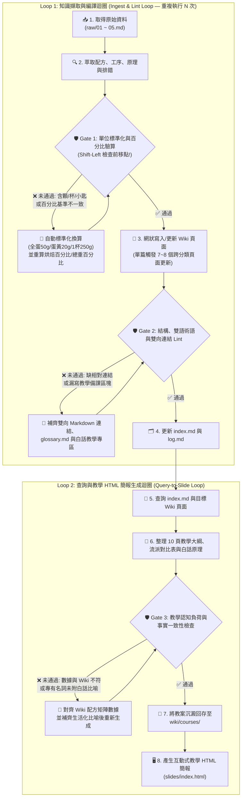

# 作業繳交報告：用 LLM Wiki 做一份教學 HTML 簡報

- **繳交標題格式**：`[學校簡稱] [學號] [系級簡稱] [姓名] 法式甜點科學與跨流派教學 LLM Wiki`
- **🔗 LLM Wiki GitHub 成果連結**：https://github.com/Iris040407/Dessert-LLM-Wiki
- **🖥️ 教學 HTML 簡報線上瀏覽連結 (GitHub Pages)**：https://iris040407.github.io/Dessert-LLM-Wiki/slides/
- **核心 Schema 規範**：[`AGENTS.md`](https://github.com/Iris040407/Dessert-LLM-Wiki/blob/main/AGENTS.md)
- **Wiki 全局索引與日誌**：[`wiki/index.md`](https://github.com/Iris040407/Dessert-LLM-Wiki/blob/main/wiki/index.md) ｜ [`wiki/log.md`](https://github.com/Iris040407/Dessert-LLM-Wiki/blob/main/wiki/log.md)

---

## 一、LLM Wiki 主題與簡短介紹

### 1. 主題名稱
**法式甜點科學與跨流派教學知識庫 (French Pastry Science & Cross-School Teaching LLM Wiki)**

### 2. 簡短介紹（為什麼選擇這個主題？解決了什麼問題？）
傳統上看甜點食譜或使用一般 RAG 問答時，初學者常面臨三大痛點：
1. **食譜單位與份量各自為政**：A 名廚寫「全蛋 4 顆、泡打粉 1.5 小匙」，B 學校寫「全蛋 150g、泡打粉 6g」，無法直接並排比較水份、油脂與糖粉比例。
2. **只給步驟不講科學原理**：食譜只寫「冷藏靜置過夜」、「煮到冒大泡」，卻沒解釋背後的物理化學機制，導致新手稍微改動溫度就翻車（如瑪德蓮沒肚臍、可麗露白頭、馬卡龍空心、卡士達隔天化水）。
3. **跨食譜的矛盾無人整理**：例如「為什麼瑪德蓮跟可麗露都要冷藏靜置過夜，但瑪德蓮要 8°C 冰麵糊入爐，可麗露卻必須回溫到 18°C 常溫入爐？」

本專案參考 Andrej Karpathy 的 **LLM Wiki** 架構，採用**「先討論、後生成」**的方式與 Agent 共同制定 [`AGENTS.md`](AGENTS.md)，匯入（Ingest）**5 篇涵蓋法式常溫蛋糕、銅模甜點、蛋白霜與基礎內餡的原始文獻（`raw/01` ~ `raw/05`）**，由 LLM 自動執行單位標準化、計算**烘焙百分比（總粉量=100%）**，編譯並維護出 **16 個高度網狀互連的 Markdown 知識頁面（`wiki/`）**，最後再以此 Wiki 為唯一知識來源，產出一份讓零基礎新手也能秒懂的 **10 頁互動式教學 HTML 簡報（[`slides/index.html`](slides/index.html)）**。

---

## 二、LLM Wiki 成果與教學 HTML 簡報連結

### 1. 第一層：不可變原始資料 (`raw/` — 共 Ingest 5 篇)
1. [`raw/01-madeleine-ph-vs-classic.md`](raw/01-madeleine-ph-vs-classic.md) — 瑪德蓮兩大名廚流派（Pierre Hermé vs 日本菓子學校）與凸肚臍熱力學
2. [`raw/02-financier-beurre-noisette-science.md`](raw/02-financier-beurre-noisette-science.md) — 費南雪與焦化奶油（*Beurre Noisette*）的三階段梅納反應科學
3. [`raw/03-canele-bordeaux-starch-gelatinization.md`](raw/03-canele-bordeaux-starch-gelatinization.md) — 波爾多可麗露澱粉糊化、靜置 48 小時脫氣與「白頭（*Cul Blanc*）」排錯
4. [`raw/04-macaron-meringue-schools-troubleshooting.md`](raw/04-macaron-meringue-schools-troubleshooting.md) — 馬卡龍法式 vs 義式蛋白霜（118°C）泡沫物理學與空心/無裙邊排錯
5. [`raw/05-creme-patissiere-ganache-emulsion.md`](raw/05-creme-patissiere-ganache-emulsion.md) — 法式兩大靈魂內餡：卡士達醬 α-澱粉酶化水危機與甘納許中心同心圓乳化法

### 2. 第二層：LLM 編譯維護之 Wiki 知識庫 (`wiki/` — 共 16 個頁面)
- **索引、日誌與多語詞彙表**：[`wiki/index.md`](wiki/index.md) ｜ [`wiki/log.md`](wiki/log.md) ｜ [`wiki/glossary.md`](wiki/glossary.md)
- **🍰 甜點品項與跨流派配方矩陣 (`wiki/recipes/`)**：
  - [`madeleine.md`](wiki/recipes/madeleine.md) ｜ [`financier.md`](wiki/recipes/financier.md) ｜ [`canele.md`](wiki/recipes/canele.md) ｜ [`macaron.md`](wiki/recipes/macaron.md) ｜ [`creme-patissiere-and-ganache.md`](wiki/recipes/creme-patissiere-and-ganache.md)
- **🥣 烘焙技法與物理化學原理 (`wiki/techniques/`)**：
  - [`maillard-and-beurre-noisette.md`](wiki/techniques/maillard-and-beurre-noisette.md) ｜ [`emulsion-science.md`](wiki/techniques/emulsion-science.md) ｜ [`starch-gelatinization-and-resting.md`](wiki/techniques/starch-gelatinization-and-resting.md) ｜ [`meringue-aerating-systems.md`](wiki/techniques/meringue-aerating-systems.md)
- **🧈 原料與食材科學 (`wiki/ingredients/`)**：
  - [`butter-and-fats.md`](wiki/ingredients/butter-and-fats.md) ｜ [`flours-and-nut-powders.md`](wiki/ingredients/flours-and-nut-powders.md) ｜ [`sugars-and-invert-syrup.md`](wiki/ingredients/sugars-and-invert-syrup.md)
- **🔍 排錯總表、主廚流派與沉澱教案 (`wiki/troubleshooting/`, `chefs/`, `courses/`)**：
  - [`common-baking-failures.md`](wiki/troubleshooting/common-baking-failures.md) ｜ [`pierre-herme-and-schools.md`](wiki/chefs/pierre-herme-and-schools.md) ｜ [`french-pastry-science-101.md`](wiki/courses/french-pastry-science-101.md)

### 3. 輸出層：最外層總入口 (`index.html`) 與 5+1 份互動式教學 HTML 簡報 (`slides/`)
- **🌟 最外層 Wiki 教學簡報中心總入口 (`index.html`)**：https://iris040407.github.io/Dessert-LLM-Wiki/
- **📊 跨品項綜合總論簡報 (`slides/index.html` — 共 10 頁)**：https://iris040407.github.io/Dessert-LLM-Wiki/slides/index.html
- **5 篇 Ingest 主題各自生成之 5 份獨立單元教學 HTML 簡報（各 5 頁，共 25 頁）**：
  1. 🐚 **簡報 01（瑪德蓮專題）**：https://iris040407.github.io/Dessert-LLM-Wiki/slides/01-madeleine.html
  2. 🧱 **簡報 02（費南雪與焦化奶油專題）**：https://iris040407.github.io/Dessert-LLM-Wiki/slides/02-financier.html
  3. 🔔 **簡報 03（波爾多可麗露糊化與白頭專題）**：https://iris040407.github.io/Dessert-LLM-Wiki/slides/03-canele.html
  4. 🍬 **簡報 04（法式馬卡龍蛋白霜物理專題）**：https://iris040407.github.io/Dessert-LLM-Wiki/slides/04-macaron.html
  5. 🍮 **簡報 05（卡士達醬澱粉酶與甘納許乳化專題）**：https://iris040407.github.io/Dessert-LLM-Wiki/slides/05-creams-and-ganache.html

---

## 三、步驟三：Loop / Graph 流程設計說明

### 1. Dual-Loop Graph 系統流程圖

本系統在 [`AGENTS.md`](AGENTS.md) 中設計了 **「雙迴圈圖譜（Dual-Loop Graph）」**，將「知識庫編譯維護（Loop 1）」與「查詢及教學簡報生成（Loop 2）」明確解耦，並設置 **3 個檢查節點（Verification Gates）**：

### 2. 詳細說明：哪些步驟會重複執行？哪些地方需要檢查或重新生成？為什麼這樣設計？

1. **哪些步驟會重複執行？（Compounding Iteration）**
   - **Loop 1（步驟 1 → 2 → Gate 1 → 3 → Gate 2 → 4）會隨每篇新資料匯入而重複執行（本次共執行 5 輪）**。
   - 更重要的是，在步驟 3「網狀寫入/更新 Wiki 頁面」中，**不是「1 篇原始檔只產出 1 篇摘要」**，而是每匯入 1 篇資料，就會同時更新 `recipes/`、`techniques/`、`ingredients/`、`troubleshooting/`、`chefs/` 與 `glossary.md` 等 **7~8 個既有頁面**。隨著 Ingest 次數增加，跨品項的綜合比較（如瑪德蓮 vs 費南雪、瑪德蓮冰入爐 vs 可麗露回溫入爐）會在技法頁中不斷累積深化。
2. **哪些地方需要檢查或重新生成？（三大檢查節點 Gates）**
   - **`Gate 1（單位標準化與百分比驗算 — Ingest 寫入前檢查）`**：檢查原始食譜是否混用非克數單位（顆、杯、小匙）、是否混淆「焦化前生奶油重 vs 焦化後淨重」、以及是否選對百分比基準（含粉類用「總粉量=100%」，無粉類內餡用「總重=100%」）。未通過則立即觸發 `FIX1` 重新換算。
   - **`Gate 2（結構、雙語術語與雙向連結 Lint — 寫入後健檢）`**：檢查每個頁面是否包含必填的 YAML Frontmatter、「🎓 教學備課專區（白話文、常見失誤、檢核點）」以及雙向相對路徑連結（防止孤兒頁面）。
   - **`Gate 3（教學認知負荷與事實一致性檢查 — 簡報生成前檢查）`**：針對「讓原本不熟悉該主題的初學者理解」之目標，檢查簡報大綱是否所有專有名詞皆附有白話比喻，且所有百分比與溫度數據與 Wiki 表格 100% 一致，否則退回 `FIX3` 重新生成。
3. **為什麼這樣設計？**
   - 把繁瑣且容易出錯的「數據清洗、跨流派對齊與原理解析」在 **Loop 1** 編譯期一次做好並固化在 Wiki 中；當 **Loop 2** 要製作教學 HTML 簡報時，AI 不必重新從混亂的原始文件中湊答案，只需直接從 `wiki/` 抽取已經驗證過的乾淨矩陣與白話模組，既消除了幻覺，又能將編纂好的教案回存至 `wiki/courses/`，讓知識庫持續複利成長。

---

## 四、一次實際執行的結果與檢查紀錄（節錄自 `wiki/log.md`）

以下為實際執行 5 篇 Ingest 與簡報生成時，在 [`wiki/log.md`](wiki/log.md) 中留下的真實檢查攔截與修正紀錄：

| 執行批次 | 原始資料來源 | Gate 1 檢查發現之問題 (攔截紀錄) | 觸發修正動作 (Fix Action) | 連動更新之 Wiki 頁面數 |
| :--- | :--- | :--- | :--- | :---: |
| **Ingest #1** | `raw/01-madeleine-ph-vs-classic.md` | ❌ PH 配方寫 `全蛋 4 顆`、`泡打粉 1.5 tsp`，無法與日系配方（`150g`、`6g`）並排算百分比 | 🔧 依 `AGENTS.md` 係數換算為 `全蛋 200g (100%)`、`泡打粉 6g (3%)`，算出 PH 總液粉比 `125%` vs 日系 `100%` | 更新 7 頁（新建 `madeleine.md`、`emulsion-science.md` 等） |
| **Ingest #2** | `raw/02-financier-beurre-noisette-science.md` | ❌ 1. 含低粉 60g + 杏仁粉 60g，單以低粉為基準會使糖油比飆至 250%；2. 流派 A 寫「焦化前生重 180g」vs 流派 B「焦化後淨重 140g」 | 🔧 1. 確立以**總粉量（低粉+杏仁粉=120g=100%）**為基準；2. 扣除 16% 蒸發水分將生重 180g 換算標註為 `焦化淨重 ~148g (123.3%)` | 更新 8 頁（新建 `financier.md`、`maillard-and-beurre-noisette.md` 等） |
| **Ingest #3** | `raw/03-canele-bordeaux-starch-gelatinization.md` | ❌ 波爾多傳統派寫 `牛奶 2 杯`、`全蛋 2 顆`、`蛋黃 2 顆`；且發現與瑪德蓮「入爐溫度」完全相反 | 🔧 換算為 `牛奶 500g (500%)`、`全蛋 100g (100%)`、`蛋黃 40g (40%)`，得出 **680% 超高液粉比**；並於靜置科學頁新增「瑪德蓮 8°C 冰入爐 vs 可麗露 18°C 回溫入爐」對照表 | 更新 7 頁（新建 `canele.md`，大幅擴充 `starch-gelatinization-and-resting.md`） |
| **Ingest #4** | `raw/04-macaron-meringue-schools-troubleshooting.md` | ❌ 馬卡龍無小麥麵粉（0g），且義式派將蛋白拆為兩半（37g 拌粉 + 37g 打發） | 🔧 以唯一粉體骨架 **細杏仁粉 100g = 100%** 為基準，合併標註義式總蛋白比為 `74% (37%+37%)` 對照法式的 `80%` | 更新 7 頁（新建 `macaron.md`、`meringue-aerating-systems.md` 等） |
| **Ingest #5** | `raw/05-creme-patissiere-ganache-emulsion.md` | ❌ Ferrandi 卡士達寫 `蛋黃 5 顆`；且甘納許完全無粉（總粉量=0g），套用烘焙百分比會除以零錯誤 | 🔧 換算 `5 顆蛋黃 = 100g`；無粉/液態內餡依規範改採 **「總重百分比（Total Weight = 100%）」** 並列對牛奶比與巧鮮比（1:1 vs 1:1.5） | 更新 8 頁（新建 `creme-patissiere-and-ganache.md` 等） |

---

## 五、步驟四：實作反思 (Reflection)

### 1. 哪一個節點最常出錯？
在實際建立甜點教學 Wiki 的過程中，**「將不同來源的原始食譜整合進同一張跨流派配方對照矩陣（Recipe Matrix Synthesis）」** 這個節點最常出錯。原因有二：
1. **原始單位與狀態不統一**：不同食譜混用「顆、杯、小匙」與「公克」，甚至同一種原料處於不同物理狀態（例如 A 食譜寫「生奶油 180g 拿去煮焦」，B 食譜寫「取煮好過濾後的焦化奶油淨重 140g」——兩者其實差了 16% 蒸發掉的水分！）。
2. **百分比分母基準衝突**：一般蛋糕以麵粉為 100%，但遇到「低粉＋杏仁粉雙粉體系（費南雪）」、「100% 純杏仁粉無麵粉體系（馬卡龍）」或「完全無粉的液態乳化體系（甘納許）」時，若沒有明確的基準規則，算出的百分比會完全失真甚至除以零。

### 2. 你發現問題後，把檢查往前移到了哪一個步驟？（Shift-Left Validation）
- **原本的檢查位置（太晚）**：最初若只在最後一步「產生教學 HTML 簡報（Loop 2）」時才做內容檢查，會發現簡報上的跨流派比較表單位對不攏、百分比加總矛盾，這時不僅要退回修改簡報，還得回頭翻找 5 篇 `raw/` 原始檔並逐一重寫 `wiki/recipes/` 裡的所有頁面，返工成本極高。
- **往前移之後的位置（Gate 1）**：我們將這個檢查大幅往前移（Shift-Left）到 **Loop 1 的步驟 2 與步驟 3 之間——也就是「剛從 Raw Source 萃取完資料、尚未寫入任何 Wiki 頁面之前」**，設立了強制性的 **`Gate 1: 單位標準化與百分比驗算檢查點`**。任何原始配方在寫入 Wiki 前，都必須先通過公制克數換算、蒸發水分補償標註與分母基準驗算。

### 3. 你有沒有因此修改 workflow / graph？為什麼？
**有的！我們因此對 `AGENTS.md` 中的 Workflow / Graph 做了兩項關鍵修改：**
1. **將單一線性流程改為「雙迴圈 + 三道檢查閘門（Dual-Loop with 3 Verification Gates）」**：
   - 在 **Loop 1（Ingest 迴圈）** 前端加入 **`Gate 1（數據與單位標準化）`** 與末端加入 **`Gate 2（雙向連結與教學備課區塊 Lint）`**。
   - 在 **Loop 2（簡報生成迴圈）** 加入 **`Gate 3（初學者認知負荷與白話比喻檢查）`**，並新增「先沉澱教案至 `wiki/courses/french-pastry-science-101.md` 再渲染 `slides/index.html`」的節點。
2. **為什麼這樣修改？**
   - **源頭防呆（Garbage In, Garbage Out 防護）**：在 `Gate 1` 就把單位與烘焙百分比算對並寫入 Wiki，確保 `wiki/` 層永遠是 **Single Source of Truth（唯一且乾淨的真實知識源）**。
   - **降低簡報生成階段的認知與計算負擔**：當資料進入 Loop 2 要生成 HTML 簡報時，因為數據在 Loop 1 已經 100% 標準化，且每個 Wiki 頁面在 `Gate 2` 就已經強制預寫好「💡 給初學者的原理白話文」，使得最終產出 [`slides/index.html`](slides/index.html) 時不僅數據零錯誤，教學可讀性也大幅提升！
