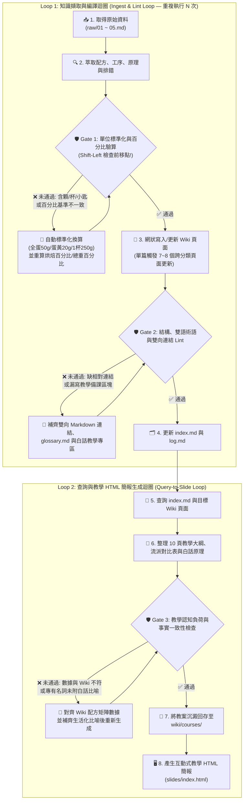

# 🍰 法式甜點科學與跨流派教學知識庫 (French Pastry Science & Teaching LLM Wiki)

> **作業主題**：用 LLM Wiki 做一份教學 HTML 簡報  
> **GitHub 帳號**：`Iris040407`  
> **核心檔案快速導覽**：
> - 🖥️ **[互動式教學 HTML 簡報 (`slides/index.html`)](slides/index.html)** *(若已開啟 GitHub Pages，可直接點此線上瀏覽)*
> - 📜 **[完整作業繳交報告 (`HOMEWORK_REPORT.md`)](HOMEWORK_REPORT.md)** *(含 Loop/Graph 設計、執行紀錄與 Shift-Left 反思)*
> - ⚙️ **[LLM Wiki 核心規範 (`AGENTS.md`)](AGENTS.md)** *(定義三層架構、Dual-Loop Graph 與 Gate 1~3 檢查點)*
> - 🗂️ **[Wiki 全局內容索引 (`wiki/index.md`)](wiki/index.md)** ｜ 🕒 **[時間軸操作與檢查日誌 (`wiki/log.md`)](wiki/log.md)**

---

## 一、LLM Wiki 主題與簡短介紹

傳統上看甜點食譜或使用一般 RAG 問答時，初學者常面臨三大痛點：
1. **食譜單位與份量各自為政**：A 名廚寫「全蛋 4 顆、泡打粉 1.5 小匙」，B 學校寫「全蛋 150g、泡打粉 6g」，無法直接並排比較水份、油脂與糖粉比例。
2. **只給步驟不講科學原理**：食譜只寫「冷藏靜置過夜」、「煮到冒大泡」，卻沒解釋背後的物理化學機制，導致新手稍微改動溫度就翻車（如瑪德蓮沒肚臍、可麗露白頭、馬卡龍空心、卡士達隔天化水）。
3. **跨食譜的矛盾無人整理**：例如「為什麼瑪德蓮跟可麗露都要冷藏靜置過夜，但瑪德蓮要 8°C 冰麵糊入爐，可麗露卻必須回溫到 18°C 常溫入爐？」

本專案參考 Andrej Karpathy 的 **LLM Wiki** 架構，採用**「先討論、後生成」**的方式與 Agent 共同制定 [`AGENTS.md`](AGENTS.md)，匯入（Ingest）**5 篇涵蓋法式常溫蛋糕、銅模甜點、蛋白霜與基礎內餡的原始文獻（`raw/01` ~ `raw/05`）**，由 LLM 自動執行單位標準化、計算**烘焙百分比（總粉量=100%）**，編譯並維護出 **16 個高度網狀互連的 Markdown 知識頁面（`wiki/`）**，最後再以此 Wiki 為唯一知識來源，產出一份讓零基礎新手也能秒懂的 **10 頁互動式教學 HTML 簡報（[`slides/index.html`](slides/index.html)）**。

---

## 二、專案目錄結構與 Wiki 成果連結

```text
Dessert/
├── AGENTS.md                 # 核心 Schema 規範與 Loop/Graph 工作流定義
├── HOMEWORK_REPORT.md        # 作業繳交報告（含 Loop/Graph 設計說明、執行紀錄與反思）
├── raw/                      # 【第一層：不可變原始資料 (共 5 篇)】
│   ├── 01-madeleine-ph-vs-classic.md
│   ├── 02-financier-beurre-noisette-science.md
│   ├── 03-canele-bordeaux-starch-gelatinization.md
│   ├── 04-macaron-meringue-schools-troubleshooting.md
│   └── 05-creme-patissiere-ganache-emulsion.md
├── wiki/                     # 【第二層：LLM 維護知識庫 (共 16 頁)】
│   ├── index.md              # 全局內容目錄（Content-oriented Catalog）
│   ├── log.md                # 時間軸操作與檢查日誌（Chronological Audit Log）
│   ├── glossary.md           # 烘焙多語專有名詞對照表（繁中 / 法 / 英 / 日）
│   ├── recipes/              # 🍰 5 大甜點品項與跨流派配方對照矩陣頁
│   ├── techniques/           # 🥣 4 大烘焙技法與物理化學原理頁
│   ├── ingredients/          # 🧈 3 大原料與食材科學頁
│   ├── troubleshooting/      # 🔍 五大經典翻車排錯總表頁
│   ├── chefs/                # 👨‍🍳 主廚與三大烘焙流派體系比較頁
│   └── courses/              # 🎓 教學備課教案與簡報大綱沉澱頁
└── slides/                   # 【輸出層：互動式教學 HTML 簡報】
    └── index.html            # 基於 Wiki 生成的 10 頁初學者甜點科學教學簡報
```

---

## 三、Dual-Loop Graph 流程設計與檢查前移 (Shift-Left Validation)



完整的 **Loop / Graph 設計說明**、**5 次 Ingest 的 Gate 1 攔截與換算檢查表**，以及 **實作反思（哪個節點最常出錯？如何將檢查往前移？）** 請參閱 **[`HOMEWORK_REPORT.md`](HOMEWORK_REPORT.md)**。
